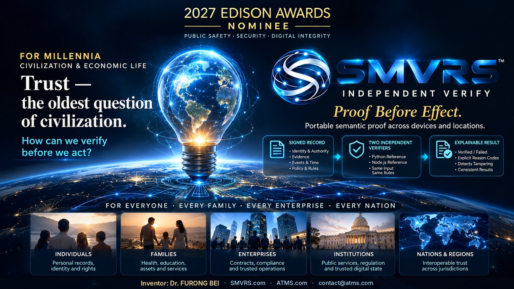
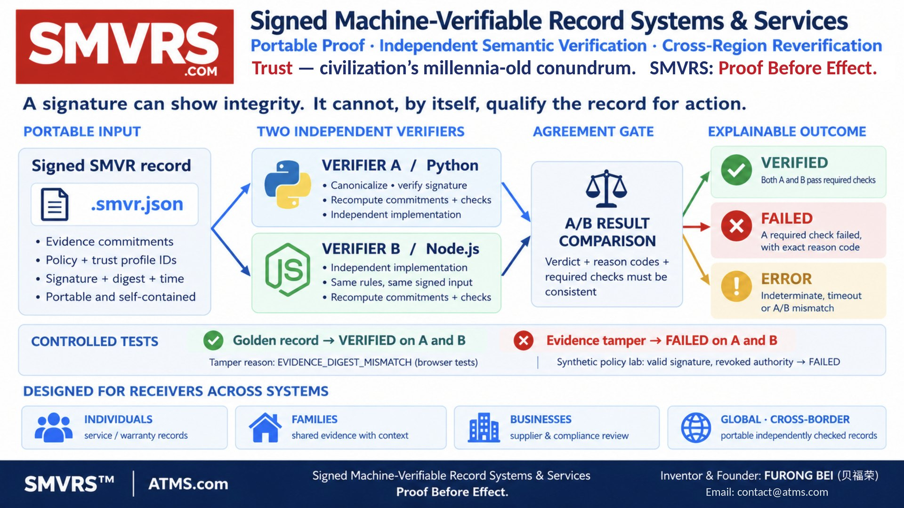

# SMVRS™ Independent Verify — Proof Before Effect

**Signed Machine-Verifiable Record Systems & Services**
2027 Edison Awards Nominee · Public Safety, Security & Digital Integrity
Inventor: Dr. FURONG BEI · BEI × ATMS · [atms.com](https://atms.com)

## Trust — civilization's millennia-old conundrum

For millennia, trust has been a foundation of civilization and economic life. From clay tablets and ledgers to today's interconnected digital systems, humanity has faced one persistent question:

> **How can we independently verify a claim before we act upon it?**

SMVRS™ answers with portable proof, independent semantic verification and explainable, machine-readable results: **Proof Before Effect.**

## How it works

1. **Portable record** — a signed `.smvr.json` carries identity and authority, SHA-256 evidence commitments, events, time and a pinned rule profile.
2. **Two verifiers** — Python (A) and Node.js (B), built separately from one specification, recompute the proof on the receiver's side.
3. **Agreement gate** — a record is VERIFIED only when both verifiers agree.
4. **Explainable result** — VERIFIED, or FAILED with the exact reason code.

Protocol: `BEI-SMVR-0.1` · Verification profile: `SMVR-VERIFY-1`

## Concept · Value · Impact

| | |
|---|---|
| **Concept — Beyond the signature** | A digital signature establishes that a message is authentic and unchanged. SMVRS adds a second layer: it checks the relationships among identity, authority, behavior, evidence, time and policy, without relying on the issuing system's success message. |
| **Value — Independent, repeatable, explainable** | Two independently built verifiers recompute the proof. Standard cryptography (SHA-256, Ed25519), no special hardware, designed for integration through APIs. The benefit: catching a mismatched record before money, care or goods move. |
| **Impact — Trust that travels with the record** | Trust is not declared; it is independently verified. SMVRS is designed for every person, family, industry and nation, in any place, any scenario, at any time. |

## Evidence (controlled tests, October 2026)

| Input | Verifier A · Python | Verifier B · Node.js |
|---|---|---|
| Signed Golden record | VERIFIED · 18 checks | VERIFIED · 18 checks |
| Evidence tamper | FAILED | FAILED |

Reason code on both verifiers: `EVIDENCE_DIGEST_MISMATCH` at `evidence.commitment`.
Record: `smvr:6d5845d693596ca36e0c0de5`.
In the inventor's engineering tests, a record created on a server in Oregon was re-verified by both verifiers on a server in Northern California; a tampered copy was rejected.

## Foundation

SMVRS is rooted in the BEI × ATMS digital-infrastructure initiative begun in 1999 by the inventor, Dr. FURONG BEI. The underlying methods are described in **556 U.S. patent applications filed** naming the inventor, including eight directed to SMVRS methods (e.g., U.S. Application No. 19/791,206).

## 30-page companion — 13 languages

The same 30 pages, for readers around the world.

| Language | File |
|---|---|
| English | [SMVRS_Edison_2027_Public_Companion_EN.pdf](SMVRS_Edison_2027_Public_Companion_EN.pdf) |
| 中文 | [SMVRS_Edison_2027_Public_Companion_ZH.pdf](SMVRS_Edison_2027_Public_Companion_ZH.pdf) |
| Español | [SMVRS_Edison_2027_Public_Companion_ES.pdf](SMVRS_Edison_2027_Public_Companion_ES.pdf) |
| Français | [SMVRS_Edison_2027_Public_Companion_FR.pdf](SMVRS_Edison_2027_Public_Companion_FR.pdf) |
| العربية | [SMVRS_Edison_2027_Public_Companion_AR.pdf](SMVRS_Edison_2027_Public_Companion_AR.pdf) |
| Русский | [SMVRS_Edison_2027_Public_Companion_RU.pdf](SMVRS_Edison_2027_Public_Companion_RU.pdf) |
| Português | [SMVRS_Edison_2027_Public_Companion_PT.pdf](SMVRS_Edison_2027_Public_Companion_PT.pdf) |
| Deutsch | [SMVRS_Edison_2027_Public_Companion_DE.pdf](SMVRS_Edison_2027_Public_Companion_DE.pdf) |
| 日本語 | [SMVRS_Edison_2027_Public_Companion_JA.pdf](SMVRS_Edison_2027_Public_Companion_JA.pdf) |
| 한국어 | [SMVRS_Edison_2027_Public_Companion_KO.pdf](SMVRS_Edison_2027_Public_Companion_KO.pdf) |
| हिन्दी | [SMVRS_Edison_2027_Public_Companion_HI.pdf](SMVRS_Edison_2027_Public_Companion_HI.pdf) |
| বাংলা | [SMVRS_Edison_2027_Public_Companion_BN.pdf](SMVRS_Edison_2027_Public_Companion_BN.pdf) |
| Bahasa Indonesia | [SMVRS_Edison_2027_Public_Companion_ID.pdf](SMVRS_Edison_2027_Public_Companion_ID.pdf) |

`index.html` is the one-page SMVRS overview.

## Links

- SMVRS overview: https://atms.com/smvrs-proof-before-effect/
- 60-second film: https://youtu.be/HiTej_EingU
- 2027 Edison Awards nominee page: https://edisonawards.com/nominees/smvrs-independent-verify/
- SMVRS product application: https://smvrs.com/site/app
- Public beta: https://bei.app
- Patent applications (public records): https://patents.justia.com/inventor/furong-bei
- Patent applications (Google Patents): https://patents.google.com/?inventor=Furong+Bei
- Contact: contact@atms.com

---

© BEI × ATMS. All rights reserved. SMVRS™ is a trademark of ATMS.com.

**SMVRS™ — Independent Verify. Proof Before Effect.**
